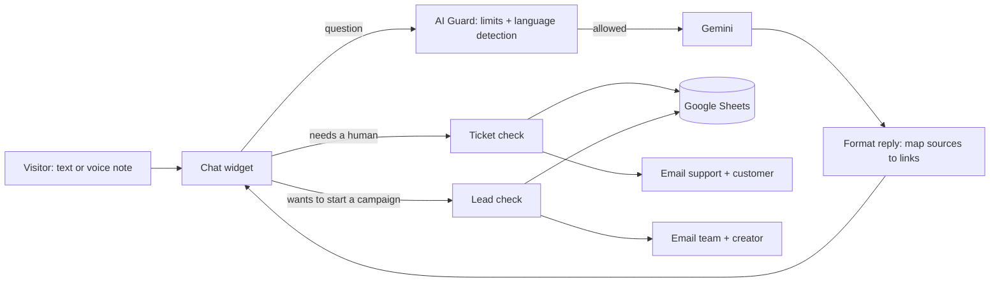

# ApnaCrowdfunding Support Agent

The AI customer support agent behind the chat widget on [apnacrowdfunding.com](https://apnacrowdfunding.com), a reward-based crowdfunding platform launching in Pakistan and other developing markets. I designed, built and tested it as AI and QA lead.

It answers questions from the help center with citations, understands English, Urdu, Roman Urdu and Arabic (typed or as voice notes), captures campaign-creator leads, and opens support tickets when the AI can't help.

## What it does

| Webhook | Job |
|---|---|
| `acf-ask` | Answers a visitor's question with Gemini, grounded in help-center facts, and returns numbered source links |
| `acf-lead` | Validates a would-be campaign creator's details, logs the lead, emails the team and the creator |
| `acf-ticket` | Validates a support request, flags urgent ones, logs it, emails support and sends the customer a receipt |
| `acf-chat-log` | Logs every conversation to Google Sheets for review |

## Architecture



## Design choices for a trustworthy support bot

- **Grounded answers only.** The model only gets a fact list where every fact carries a source ID (`[S4]`). The reply formatter turns those IDs into numbered links to the real help-center articles and drops any ID that doesn't exist, so the bot can't cite a page that isn't there.
- **Replies in the visitor's language.** It detects Urdu or Arabic script versus Roman Urdu versus English and tells the model which one to answer in.
- **Voice notes without guessing.** For audio, the model must transcribe first. If there's no clear speech, it asks the visitor to record again instead of inventing a question.
- **Cost and abuse limits.** It caps message length, answers per visitor per day, and answers for the whole site per day, so a bot can't burn the API budget.
- **Validation before anything is saved.** Names, phone numbers and emails are checked on the server. The visitor is told exactly which field to fix.
- **Urgent tickets surface first.** Tickets that mention payment, refund, fraud, scam or hacking are marked High priority.
- **A way out.** If the AI fails or the visitor isn't satisfied, "No, I need more help" opens a ticket to a human.

## Files

```
workflows/support-agent.json   n8n export of the full backend (credentials and sheet IDs removed)
```

## Setup

1. Import `workflows/support-agent.json` into n8n.
2. Add your own Gemini, Google Sheets and Gmail credentials, and replace `YOUR_GOOGLE_SHEET_ID`.
3. Update the knowledge list and source links in the **AI Guard** and **Format AI Reply** nodes, and the team email in **Lead Check** and **Ticket Check**.
4. Point your chat widget at the four webhooks.

## Stack

n8n · Google Gemini (text + audio) · Google Sheets · Gmail · JavaScript
